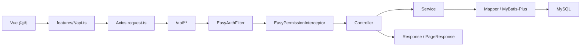
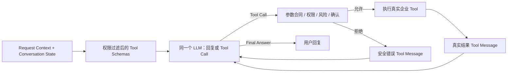
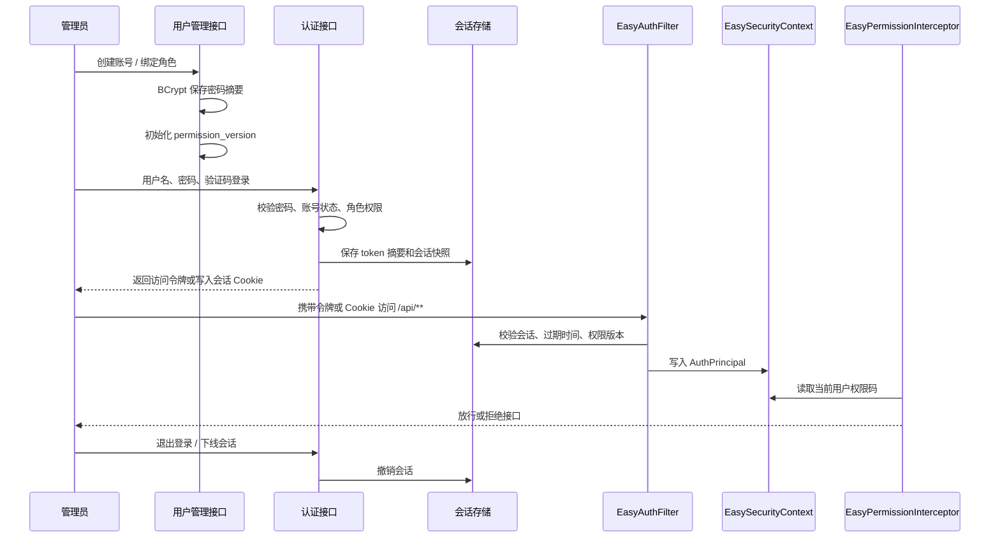

# 架构与实现原理

EasyNextAdmin 是单体优先的企业后台脚手架。后端按模块分层，菜单、路由和权限资源以数据库 `sys_menu` 为唯一事实源，前端根据登录账号返回的授权菜单动态装配页面。

## 总体结构

```text
easy-next-admin
├── easy-next-admin-server
│   ├── common          # 统一响应、异常、常量、工具
│   ├── config          # Spring、MyBatis、WebMVC、OpenAPI、线程池等配置
│   ├── infrastructure  # 认证、权限、数据范围、审计、缓存、锁、幂等、限流、观测性、AI 模型适配
│   └── module          # 系统、报表、监控、审计、调度、流程、助手、消息等业务模块
└── easy-next-admin-web
    ├── src/features     # 业务 API、类型和前端领域逻辑
    ├── src/views        # 页面
    ├── src/components   # 通用组件
    ├── src/router       # 路由守卫和动态路由解析
    ├── src/permissions  # 按钮权限码常量
    └── src/stores       # Pinia 状态
```

## 请求链路



关键点：

- 前端页面只依赖 feature API，不直接散落 Axios 调用。
- `EasyAuthFilter` 从 token 解析当前会话和用户权限。
- `EasyPermissionInterceptor` 校验控制器或方法上的 `@EasyPermission`。
- MyBatis 数据权限拦截器在查询阶段追加组织范围过滤。
- 返回值通过统一响应对象和异常处理器保持前后端契约稳定。

## 企业智能助手 Mini Agent

助手使用 Spring AI 1.1.x 作为 Spring Boot 3.5 下的模型协议适配层，不使用 Spring AI Alibaba，也不把企业 Runtime 交给框架。
项目自己的 `ToolCallingModelClient` 端口隔离 Spring AI，默认适配器把不可变消息和 `ToolDefinition` 映射到
OpenAI-compatible Chat Completions 的原生 Function Calling，并显式关闭 Spring AI 内部 Tool 执行。未来可以增加 Responses API、
其他模型 SDK 或替换 Spring AI，而不改变 AgentLoop 和业务 Tool。

普通请求不先做意图分类。`AgentTurnService` 读取 Request Context 和版本化 Conversation State 后，先用
`ToolVisibilityPolicy` 确定性过滤当前用户无权使用的 Tool，再把剩余的真实 `ToolDefinition` Schema 交给同一个模型。
模型直接选择 Tool 并生成参数；Runtime 校验、执行后把真实结果作为标准 Tool Message 回填同一个模型，直到模型生成最终回复或达到预算：



主 Agent 的 Prompt 不是一段不断拼接的长字符串，而是三层消息：

| 层 | 代码名称 | 内容与信任边界 |
| --- | --- | --- |
| 稳定系统指令 | `systemInstructions` | 身份、目标完成、事实来源、Tool、会话和安全规则；不包含本轮动态数据，便于审阅和 Prompt Cache |
| 可信运行上下文 | `trustedRuntimeContext` | 服务端生成的时间、时区、Pending Action 和 Last Result；能提供事实，但不能覆盖系统规则或代替权限校验 |
| 会话与用户输入 | `userInput` | 最近对话、被动业务记忆、Pending Action 和当前消息；只作为数据理解，不能注入系统指令 |

Trace 使用模型调用的职责名称，不再把所有请求统称为 `tool_calling_model`：

| `operationName` | 用途 | 输出上限 |
| --- | --- | --- |
| `agent_step` | 模型可直接回复或选择本轮可见 Tool | 使用全局模型配置 |
| `final_response` | Tool 面关闭后，根据已有 observation 合成最终回复 | 使用全局模型配置 |

这些名称描述职责，不绑定 Spring AI 或某个模型供应商；两类调用都经过同一个 `ToolCallingModelClient` 端口和统一预算。

Request Context 与 Conversation State 必须分开理解：前者固定当前请求的用户、权限、时区、时间点和消息；后者只保存跨轮次需要的
Chat Memory、Pending Action 与 Last Result。一次单轮 Trace 的模型耗时、Token、Step 和可见 Tool 数量不进入会话状态。
会话快照的简化结构如下：

```json
{
  "version": 7,
  "chatMemory": {
    "recentTurns": [
      {
        "userMessage": "查一下我的待办",
        "assistantMessage": "你当前有 2 个待办。",
        "completedAt": "2026-07-14T02:30:00Z"
      }
    ]
  },
  "pendingAction": null,
  "lastResult": {
    "toolName": "workflow.task.list_my_pending",
    "artifactType": "workflow.task.list",
    "summary": "找到 2 个待办任务",
    "references": [],
    "updatedAt": "2026-07-14T02:30:00Z"
  },
  "updatedAt": "2026-07-14T02:30:00Z"
}
```

Chat Memory 按完整 Turn 追加和淘汰，不会把 user/assistant 拆开。存储层保留最近 6 个完整 Turn；进入 Prompt 时再按“最近 4 轮 + 1200 字符总预算”自适应取窗，单条消息也会限长。超出预算时只保留最新的完整 Turn 并标记早期对话已省略，不增加摘要模型调用。Pending Action 和 Last Result 仍以结构化状态独立承接，且各有确定性长度上限，避免业务结果或草稿无界增长。`AssistantConversationStateStore` 以“用户 + conversationId”保存一个
完整快照；Redis 实现通过 Lua 在同一原子操作里校验 `expectedVersion`、写 JSON 和续期，内存实现用进程内 CAS 支撑单节点开发测试。
因此会话锁负责避免无意义的并发模型调用，版本校验继续阻止旧 Turn 覆盖新状态，两者职责不同。

主链可简化理解为下面的伪代码；确认/取消不使用独立 `ApprovalParser`，而是由仅在存在 Pending Action 时才暴露的控制 Tool
进入同一个 AgentLoop，因此“确认提交，然后继续查我的待办”仍能在一轮内继续执行：

```java
AssistantEntryResponse run(AssistantMessageRequest request) {
    AssistantRequestContext context = contextBuilder.build(request);

    try (TurnLease ignored = conversationTurnCoordinator.acquire(context)) {
        AssistantConversationState state = conversationStateStore.load(context);
        List<AssistantVisibleTool> tools = toolVisibilityPolicy.selectVisibleTools(context).tools();

        AgentResult outcome = agentLoop.run(context, state, tools);

        conversationStateWriter.writeTurn(
                context,
                state,                 // expectedVersion 来自这个不可变快照
                outcome.pendingActionUpdate(),
                outcome.toolResult(),
                outcome.reply()
        );
        return AssistantEntryResponse.from(outcome);
    }
}
```

`AgentLoop.run` 只保留一次 Tool round 和协议修复所需的小循环，不再为“继续/完成”定义一套迭代枚举：

```java
AgentLoopState state = start(context, conversationState, visibleTools);
for (int step = 1; step <= maxSteps; step++) {
    ToolCallingResponse response = modelClient.call(messagesAndVisibleTools(state));

    if (response.hasToolCalls()) {
        List<ToolCall> requestedToolCalls = toolCallProcessor.normalizeRequestedToolCalls(response.toolCalls());
        state.addMessage(ToolCallingMessage.assistant(response.content(), requestedToolCalls));

        Optional<AgentResult> waitingForUser = toolCallProcessor.executeRequestedToolCalls(requestedToolCalls);
        if (waitingForUser.isPresent()) {
            return waitingForUser.get();
        }
        continue;
    }

    if (response.hasContent()) {
        return finalAnswer(response.content());
    }
    return invalidModelResponse();
}
return deterministicFallback(state);
```

`response.toolCalls()` 是模型根据可见 Tool Schema 提出的调用请求，不代表业务已经执行。Runtime 先把这次
`assistant(tool_calls)` 原样加入消息历史，再经 `ToolCallProcessor -> BusinessToolCallHandler -> AssistantToolRunner -> AssistantTool.execute`
完成 Schema、权限、风险、确认、幂等和真实业务调用；随后以相同 `toolCallId` 追加 `tool(result)` observation。这个顺序是
Chat Completions / Claude Tool Use 等原生 Tool 协议的会话结构要求，也保证下一次模型调用能知道“哪个请求对应哪个结果”。

`ToolCallProcessor` 逐个执行 Tool Call，把 observation 放回消息历史，并直接使用业务已有的
`ToolExecutionStatus` 决定工具面和暂停点：

```java
for (ToolCall call : response.toolCalls()) {
    var step = executeThroughDeterministicBoundary(call);
    messages.add(toolObservation(step));
    updateToolSurface(step.plan().status());
    if (step.waitsForUser()) return deterministicFallback(state);
}
closeToolSurfaceAfterCompletedRound(state);
```

`ToolExecutionStatus` 描述业务计划处于查询、缺字段、待确认、已确认等哪种状态；AgentLoop 不再把同一事实翻译为
`CONTINUE / COMPLETED` 和 `NextAction` 两层重复状态。`AssistantPendingActionUpdate` 仍用
`UNCHANGED / UPSERT / CLEAR` 独立记录跨轮会话状态转移，因此最后一个只读查询即使覆盖
`lastPlan`，也不会把前面已经形成或确认完成的写动作状态覆盖掉。

“智能”首先来自模型直接面对真实能力和 observation，而不是 Router、Selector、参数抽取、Replan、Response 多个模型调用串行猜测。
Tool 合同必须提供完成用户目标所需的最小充分结果：例如流程列表项已经包含流程标识、标题、当前节点和状态，查看“最近一个流程的进度”
只需要一次列表查询，不应再扩查流程详情和业务申请单。首次模型响应可以并列提交多个相互独立的只读 Tool；批次执行后 Runtime
统一关闭 Tool 面，只根据已有 observation 生成最终回复。参数协议错误仍可以在预算内修复，缺字段和写草稿则等待用户。
Agent Step 和无 Tool 最终回复共享一个简单的模型调用计数器；
批次后的最终调用不会携带 Tool，
不会在 Tool 已经执行后因为预算边界直接退回模板文案。普通直答只调用一次主模型；单个 LOW 风险只读 Tool 通常是
“选择 Tool + observation 后合成”两次模型调用。缺字段和写操作草稿直接使用服务端确定性文案停在确认点，不增加润色或审查调用。
每轮默认最多 6 次模型调用、6 次 Tool Call；
相同 Tool + 参数不会重复执行。模型返回损坏的参数 JSON 时不会降级为空参数执行，而是回填可重试的失败 observation 让模型自行修正；
模型不可用或预算耗尽时保留已经得到的真实结果并安全停止。协议适配层还会把供应商的 `stop / tool_calls / length /
max_tokens / content_filter / refusal` 等结束原因归一化为 `ModelFinishReason`；截断文本不会返回用户，截断的 Tool Call 绝不执行，
过滤、拒绝和未知非空终态采用 fail-closed。若截断前已经获得真实 Tool observation，则回退到该确定性结果，不丢掉已经完成的工作。
循环预算在启动期校验，并在 Runtime 再次夹紧，避免错误配置形成无界循环。

Agent Run 使用独立的 `AgentTerminationReason` 说明循环为什么停止，它不复用 `ToolExecutionStatus` 或
`AssistantToolRunStatus`。正常最终回复、等待补参、等待确认、安全策略阻止、重复 Tool Call、模型/Tool
调用预算耗尽，以及模型错误、截断、过滤、拒绝、暂停和协议异常都有明确枚举。这样一个已经成功执行 Tool、
但在最终合成阶段遇到模型异常的回合，可以同时表达“Tool 结果已保留”和“Agent 因模型错误停止”，不会被一个
笼统的 `BLOCKED` 覆盖。终止原因进入同步调试响应、Agent Run Trace 和低基数指标；普通用户仍只接收精简状态。

模型选中 Tool 后，Runtime 直接使用标准 `ToolDefinition.name` 记录工具身份，不存在固定 Intent 枚举或 Route，也不再维护一份重复的
`capabilities` 能力字符串。模型的选择语义只来自 `description` 和 `inputSchema`；`subjectScope` 则向 Runtime 明确声明
`NONE / CURRENT_USER / AUTHORIZED_TARGET`，不让它用“参数是否为空”猜测 Tool 实际查询谁。新增业务能力只需增加 Tool。Pending Action 的补字段由原业务 Tool 继续完成；明确确认和取消由仅在存在待处理动作时动态暴露的内部控制 Tool 完成，
确认时复用服务端已保存的动作 ID、参数快照和幂等键。这是写操作安全状态机，不是普通请求的前置意图路由。
例如“核对请假单号对应的申请人、时间和原因”由独立 `workflow.leave.detail` 查询真实请假业务数据，
不会把请假表查询硬编码进通用 `workflow.process.detail`；后者只负责流程节点和审批进度。这种边界让企业迭代保持为新增 Tool 和查询适配器，而不是修改 Router 分支。

“企业”边界由模型外的确定性组件保证：

- `ToolVisibilityPolicy` 只向模型暴露当前用户有权限的真实 Tool；真实 Tool 执行前仍再次检查业务权限和数据范围。
- `ToolDefinition` 同时声明输入输出 Schema、主体作用域、执行模式、风险级别和权限；模型只能建议调用，不能授予权限或绕过校验。
- `AssistantToolRegistry` 在应用启动时校验标准机器名、Schema 重复字段和执行接口；写 Tool 未实现 `ConfirmableTool` 会直接启动失败。
- 原生 Tool Call 参数只接受 Schema 内字段，日期、枚举、业务标识和领域不变量继续确定性校验；普通语义字段允许模型同义归纳，
  不再要求与用户原话逐字匹配。
- 写操作实现 `ConfirmableTool`，第一次调用只能 `prepare` 草稿；确认后才进入 `executeConfirmed`。同一模型响应包含一个写 Tool 和只读 Tool 时，
  Runtime 按“只读在前、写入在后”串行调度，每项仍独立经过参数、权限和执行策略；多个写操作会整体拒绝并要求拆分。草稿形成后先保存确认 checkpoint；确认成功会显式清除 Pending Action，
  然后只向模型保留只读 Tool，使“确认提交，然后继续查待办”能够续跑又不能顺手执行第二个写操作。
- 写 Tool 的原始 Schema 保留完整领域必填约束；模型协议层使用派生的部分草稿 Schema，允许只提交用户明确给出的字段，
  再由服务端原始合同返回缺失参数，避免 Function Calling 为凑齐 required 字段而编造默认值。
- 草稿准备成功后，`ConfirmableTool.confirmationArguments` 会生成确认阶段原样重放的服务端参数快照；例如先把业务单号解析成
  稳定 `taskId`，确认时不再根据可能已经变化的流程状态重新选择目标，避免并发下确认对象漂移。
- 确认执行继续使用接口权限、数据权限、动作 ID、强制幂等和审计；缺少幂等键会直接拒绝执行。进入真实写边界后出现失败时采用
  fail-closed，不自动删除幂等键，因为失败可能发生在数据库提交之后或 Tool 输出校验阶段。再次收到相同幂等键时返回
  `INDETERMINATE`，不伪装成已成功、不清除 Pending Action，要求先查询业务状态或人工核对；`CRITICAL` 动作默认要求外部审批或人工处理。
- 相反业务动作不能靠一个自由文本参数区分：待办同意和驳回使用独立 `workflow.task.approve` / `workflow.task.reject` Tool、
  独立权限和独立审计，共享的只有安全目标解析服务，避免把“驳回”误装成“同意 Tool 的审批意见”。
- 多步聚合结果会在写入 Last Result 前展开，并由注册表按引用类型统一生成连续 `index`；各业务
  `AssistantRunReferenceExtractor` 仍只处理自己的单 Tool 结果。因而下一轮“看第一个详情”使用结构化业务引用，
  不会因聚合中的每个单项都从 `index=1` 开始而选错，也不依赖聊天文本猜测。
- 模型调用继续进入助手 Run Trace，单次调用拆分请求准备、模型网关往返和响应处理，ToolRunner 也独立计时并保留模型 `toolCallId`，便于把模型选择与真实执行对应起来；整轮汇总模型、Tool 与其他运行时耗时，并通过低基数 Micrometer Timer 按 operation、model、decision 聚合 p50/p95/p99。同步 Chat Completions 无法区分供应商排队、TTFT 和纯生成时间，因此只记录真实可测的网关往返，TTFT/生成字段保持空值，不能用估算值冒充。真实工具自身仍必须执行数据权限和业务权限校验，不能把 Agent 工具可见性当作最终鉴权。
- Tool observation 已产生后，如果下一次模型汇总因瞬时网关异常失败，AgentLoop 会在统一模型预算内最多恢复一次；恢复仍使用原消息历史和已保存 observation，同一 Tool Call 签名继续去重，不会重放写操作。第二次失败立即采用确定性结果回退，避免持续故障演变成隐式重试风暴。
- 成功 Tool 批次后 Runtime 会关闭整个 Tool 面；若供应商仍返回 Tool Call，则按协议失败安全停止，不执行额外业务调用。
  已有成功业务结果时，后续参数、阶段或预算协议错误不能覆盖已完成结果。
- Tool 查询优先复用业务模块已有的查询边界，并传递完整 `AssistantUserContext`；不能只传 userId 或复制一份可见性 SQL，
  否则超级管理员、部门范围和角色权限容易与 Controller 口径漂移。
- Pending Action 补字段时由原生 Tool Call 的实参键声明用户本轮明确提供或修改的字段；参数只有通过该证据边界才能合并，
  历史回显和默认值不能覆盖用户已经明确给出的值，确认动作直接使用已保存快照，不重新抽取参数。
- 上一轮 reference 只保存受控 Tool 生成的稳定标识；主模型负责判断当前消息是否明确承接，Runtime 负责 Schema、权限和 Tool 内数据范围。
  不再增加第二次模型语义审查，也不使用 Java 中文短语表或正则二次猜测意图。对象不唯一时，业务查询返回无结果或模型主动澄清；写操作仍必须经过服务端草稿与显式确认。
- 自由文本最终回复不再经过通用正则 Grounding 或 LLM critic。事实正确性放在 Tool 输入输出 Schema、领域服务状态、Pending Action 和用户界面投影中；
  缺字段、写草稿、执行失败和不确定结果直接返回确定性 Runtime 文案。若未来某入口需要严格结构化最终输出，应为该入口增加响应 Schema，而不是恢复文本匹配。
- Tool observation 是独立的模型合同，不是完整 Run Record 的 JSON 镜像。成功且已有结构化 `data` 时只回填 `status + complete + data`，不再重复 `summary / artifactType / planStatus / null`；失败时回填短 `message`，只有缺字段或待确认才附加 `next`。结构化数据按 `outputSchema` 保留顶层字段，列表、文本、对象层级和总 observation 均有确定性预算；完整业务结果仍保留在 Run State / Trace 的受控边界中。复合请求中，一个 Tool 的成功不能为其他企业制度、业务数据或实时事实背书；这一来源纪律只在稳定系统指令中维护。
- 基础算术由主模型一次直答。最小版不注册 Calculator Tool，避免简单算术随机进入两次模型调用；Runtime 也不扫描用户文本、
  不维护算术前后缀或自然语言正则路由。未来出现真实高精度核算需求时，再以独立 Tool 和版本化 eval 加回。
- 普通聊天由聊天模型回答；实时外部信息没有对应 Tool 结果时必须说明无法确认，身份和敏感凭据遵守系统边界，复合问题逐项作答。
- 未接入真实数据源的占位能力不注册为 Tool。企业制度库尚未接入时可以解释通用定义和稳定区别，但资格、额度、期限、结转、失效、折算、补偿、薪酬、是否带薪、法律责任和本公司规则没有来源就不得断言；不能把模型记忆当成本企业事实，也不使用无结果 Tool 干扰模型选择。实时天气等外部事实同样必须有对应 Tool 结果。
- Tool description 必须使用简短且对称的语义边界：“用于……；不用于……”；唯一标识、时间格式、枚举和必填约束写在字段 Schema。不把 `attributes.instanceId`、历史承接实现、内部 Tool 名跳转或安全策略复制到模型文案中。这是语义合同，不是 Java 关键词/正则路由；质量由 Tool 单测和真实模型 eval 约束。
- `/api/assistant/chat/messages/stream` 是普通用户 SSE 入口，使用 `assistant:chat`；上下文构建、会话读取、Tool 面准备、每次模型调用、Tool 选择/参数/结果和状态写回都会映射成有序的安全 Step，最后只返回包含会话 ID、用户可见回复和状态的精简终态。`/api/assistant/messages` 是同步调试与 eval 入口，使用 `assistant:debug`，返回完整 Agent Step、Tool Trace 和真实模型交互；相同 `conversationId` 与用户流一样读取并写回同一 Conversation State，只有不传 ID 时才创建新会话。模型请求包含实际消息数组、实际 Tool Schema 和生成选项；响应同时保留供应商交给 Spring AI 的文本/原始 Tool Call 参数和 AgentLoop 实际消费的归一化结果。`easy.assistant.trace.content-mode` 生产默认 `METADATA_ONLY`，不记录 Prompt、Tool 参数和结果正文；local profile 默认 `SANITIZED_CONTENT`，经 `EasySensitiveDataMasker` 脱敏且单 Payload 上限为 100000 字符。它是语义级真实模型交互，不宣称是模型网关原始 HTTP 抓包。两个入口复用同一个 Runtime，但不复用响应 DTO 或权限。
- 用户 SSE 入口使用独立的 `assistantStreamExecutor` 和注释心跳，不占用普通业务线程池。浏览器断开后事件出口停止发送，
  但传输异常不会反向中断已经开始的 Agent 业务收尾；Tool、会话状态、幂等结果和 Trace 仍按同一轮语义完成写回。
  内部 `AssistantAgentLifecycleEvent` 先经过 `AssistantUserStreamEventAdapter` 单向映射，Prompt、Tool 参数、Trace Step 和内部 payload 不会进入用户 SSE。
- 同一用户、同一会话的状态读取、模型推理和状态写回由 `AssistantConversationTurnCoordinator` 使用项目分布式锁串行化；
  获取锁采用非阻塞语义，冲突的同步请求返回 409，用户 SSE 请求返回明确的 `error` 事件，不让第二个长模型请求排队占用线程。
  锁键使用固定长度摘要兼容 Redis 和 MySQL 降级实现，租约获取后立即进入 try-with-resources，并覆盖 State Load 到 State Write；租约自动续期，释放异常只记录日志，不能覆盖已经完成的业务结果。锁后端异常采用 fail-closed，不能降级成无锁执行；该锁只保护 Agent 会话状态，业务 Tool 仍必须保留事务、幂等和自己的并发校验。
- 模型调用开始/结束、Tool 选择、参数解析、参数校验和每次 Tool 完成事件由 `AgentLoopListener` 在 AgentLoop 内真实阶段发出，
  不在 AgentLoop 结束后从最终 Plan 反推伪造中间状态。观察者仅用于诊断，SSE 断开或任意观察者异常都会被隔离。
  内部事件使用 `AssistantAgentLifecycleEventType` 和 `AssistantAgentLifecyclePhase` 枚举；Trace、SSE 适配和测试直接匹配
  类型，不维护生命周期事件字符串。普通用户 SSE 仍由单向适配器映射成安全的 `progress/done/error` 消息。
- Pending Action 的确认或取消只作用于服务端保存的原动作；新话题仍可选择其他有权限 Tool，不会被旧动作锁死。

当前内置 Tool 数量较少，因此把全部有权限的 Tool Schema 交给模型，避免词面召回误删正确能力。企业 Tool 数量超过上下文预算后，
在 `ToolVisibilityPolicy` / Tool Provider 边界增加 embedding、企业搜索或按需 Tool Search；不要重新引入“必须先命中固定 Intent”
的前置门控。`ToolCallingModelClient`、`ToolVisibilityPolicy`、`ToolExecutionPolicy` 和 Tool 接口都是替换点，业务 Tool 无需改造。

智能效果使用版本化 eval 而不是主观对话判断。`assistant/evals/enterprise-agent-v1.json` 当前覆盖直答、知识边界、Tool 选择、参数抽取、
多轮状态、写操作治理、多目标、Prompt Injection 和失败恢复；普通 CI 只校验数据集合同与确定性 Runtime，显式启用的
`AssistantLiveAgentEvalTest` 才通过已启动的本地 HTTP 入口调用真实模型和真实 Tool。
真实用户或 live eval 暴露的每个失败对话都按原始多轮消息先加入该回归集，再修 Runtime、Prompt 或 Tool 合同；不使用删减后的近似问题代替真实失败。

核心代码位于 `module/assistant/runtime`。该包保持显式 Java 接口和不可变消息对象，不实现通用 Graph DSL、动态代码执行或多 Agent 编排，
以便二开者直接读懂循环，并按需替换模型协议、Tool Provider、状态存储或整个 Runtime。
建议按下面顺序阅读代码，避免把“请求入口”和“推理循环”混为一层：

1. `AssistantController`：两个 HTTP 入口；用户 SSE 对话返回安全阶段和精简终态，同步调试返回完整流程，两者使用同一执行链。
2. `AgentTurnService.run`：单轮总入口，依次构建不可变 Run Context、获取会话 Turn 锁、读取 Conversation State、过滤 Tool、调用 AgentLoop、写回状态和 Trace。Context 只固定身份/授权快照、会话、请求时间点、时区和规范化消息，不重复保存原始消息，也不保存可由时间点与时区推导的日期/本地时间；消息只统一换行和首尾空白，保留列表、缩进与多行结构供模型理解。给模型的可信运行上下文只发送时间、时区、Pending Action 和 Last Result；用户昵称、部门、角色和权限码不进入 Prompt，继续由 Tool 可见性与执行边界确定性判断。Context 不包含存储 Key、HTTP 审计字段或某个业务 Tool 的专属规则。
3. `ModelMessageBuilder.buildInitialMessages`：构建真正的消息数组；稳定 System Prompt 在最前，历史对话保持独立 `user/assistant` 角色，本轮可信状态使用独立 system 消息，当前用户输入是最后一条 user 消息。
4. `AgentLoop.run`：约 180 行的推理核心，使用可直接阅读的 `if (response.hasToolCalls()) { ... continue; }` 主路径，只保留模型调用、预算、单批 Tool observation、等待用户和退出条件，不直接写业务表。
5. `ToolSetBuilder`：把当前可见业务 Tool 与仅在存在草稿时出现的确认/取消 Tool 组成本轮 Tool 面。
6. `ToolCallProcessor`：处理 Tool 批次协议、调用预算、重复调用和紧凑 observation。
7. `BusinessToolCallHandler` 与 `DefaultToolExecutionPlanFactory`：绑定/校验业务 Tool 参数，并按 `ToolExecutionStatus` 转换为只读执行、缺字段或待确认草稿状态。
8. `PendingActionHandler`：只处理服务端已保存草稿的确认和取消，不从用户文本重新提取写参数。
9. `AssistantToolRunner`：二次权限、风险、确认阶段、幂等和输出合同边界；具体业务 Tool 才调用领域 Service。
10. `AgentTraceSnapshots`：只生成调试快照，不参与 Agent 决策，避免 Trace 代码淹没单轮主链。
11. `AssistantConversationStateWriter`：按 Agent 返回的显式 `AssistantPendingActionUpdate` 原子写回版本化 Chat Memory、Pending Action 和 Last Result。

多 Tool 聚合使用 `PARTIAL_SUCCESS` 表达部分成功，不再用最后一个调用的状态代表整批结果。写操作草稿生成失败时会转为
`BLOCKED`，不会留下可确认假草稿；用户已经确认但业务执行失败时保留原草稿和幂等身份。相同确认再次到达时如果无法证明
历史执行结果，状态是 `INDETERMINATE`，必须先查询真实业务状态或人工核对，不能把“收到过相同请求”误报成“业务已经成功”。

## 认证与会话

认证组件入口：

```text
POST /api/auth/login
GET  /api/auth/me
POST /api/auth/logout
GET  /api/auth/demo-accounts
```

核心实现：

```text
EasyAuthService                 # 登录、会话创建、会话恢复、退出
EasyAuthFilter                  # /api/** 请求认证过滤器
EasyPermissionInterceptor       # @EasyPermission 接口鉴权
EasySecurityContext             # 单次请求内的认证上下文
AuthSessionStore                # Redis / Memory 会话存储
PermissionVersionService        # 权限版本递增和旧会话失效
```

Servlet 过滤器统一由 `EasyServletFilterConfig` 注册，过滤器类本身不再使用 `@WebFilter`、`@Component` 或局部 `@Order`。注册名、顺序和 URL pattern 集中在 `EasyFilterOrders` 枚举：

| 顺序 | 过滤器 | 作用 |
| --- | --- | --- |
| `TRACE` | `EasyTraceIdFilter` | 最先生成或接收 `X-Trace-Id`，写入响应头和 MDC |
| `WAF` | `WafFilter` | 写可配置安全响应头，并按配置处理 XSS / SQL 注入参数过滤 |
| `CORS` | `EasyCorsFilter` | 按 `easy.web.cors` 白名单处理跨域和预检请求，避免认证过滤器拦截 OPTIONS |
| `AUTH` | `EasyAuthFilter` | 仅对 `/api/*` 恢复认证上下文和用户 MDC |

新增过滤器必须在 `EasyFilterOrders` 声明注册元数据，并通过 `EasyServletFilterConfig` 注册；不要在过滤器类上直接写注册注解，避免顺序和 URL pattern 分散。
审计请求参数从 Controller 方法参数提取并脱敏，不再为所有 JSON 请求提前缓存原始 body；如确需原始 body 日志，应使用受限路径和大小上限的显式缓存策略。

### Web MVC 扩展

MVC 扩展按职责拆分在 `config` 包下，不再集中到一个大配置类：

| 配置类 | 职责 |
| --- | --- |
| `EasyMvcInterceptorConfig` | 只注册 `/api/**` 的 HTTP 慢请求和权限拦截器；慢请求计时先执行，权限后执行，确保鉴权失败也能进入耗时排查。 |
| `EasyMvcArgumentResolverConfig` | 注册 Controller 参数解析器，目前用于安全版 `PageRequest`。 |
| `EasyMvcFormatterConfig` | 注册字符串到业务枚举的转换器。 |
| `EasyStaticResourceConfig` | 注册本地文件资源映射，并显式创建本地存储目录；前端静态资源由 Vite / Nginx / 前端镜像提供。 |

`configureHandlerExceptionResolvers` 当前不使用。异常统一交给 `GlobalExceptionHandler`，不要保留空实现，也不要在 MVC 配置里分散异常响应结构。

`addReturnValueHandlers` 当前不使用。返回值日志、审计和脱敏由审计组件、响应 Advice 和 `EasySensitiveDataMasker` 处理，不在返回值处理器里打印完整响应，避免敏感数据泄露。

`addArgumentResolvers` 只承载明确的 Controller 参数注入能力。新增解析器必须独立成类、可单测、默认拒绝不安全输入，不能在配置类中写匿名解析器。

安全分页查询通过 `PageRequestArgumentResolver` 实现。Controller 参数必须加 `@PageQuery(fields = XxxQueryField.class)`，字段枚举实现 `PageQueryField`，前端只能传 `paramName`，数据库列名只能来自服务端枚举的 `columnName`。这样既保留通用筛选和排序的开发效率，又避免客户端直接控制 SQL 列名。

完整链路：



设计说明：

1. 账号创建：用户管理只保存 BCrypt 密码摘要，角色关系写入 `sys_user_role`，不把明文密码持久化。
2. 登录认证：登录接口先执行验证码和失败次数策略，再校验账号、密码、启用状态和角色权限。
3. 会话创建：登录成功后生成随机访问令牌，服务端只保存 token 摘要和 `AuthSession` 快照，快照包含用户、角色、权限、部门、数据范围和权限版本。
4. 会话验证：每次请求由 `EasyAuthFilter` 解析令牌，校验会话状态、空闲过期时间、绝对过期时间和权限版本，并刷新活跃时间。
5. 认证上下文：过滤器把 `AuthPrincipal` 放入 `EasySecurityContext`，供权限、数据范围、审计和业务服务读取；请求结束必须清理上下文，避免线程复用串用户。
6. 接口鉴权：`EasyPermissionInterceptor` 读取 `@EasyPermission`，按当前用户权限码放行；超级管理员角色编码 `admin` 可跳过权限码校验。
7. 退出和治理：退出登录撤销当前会话；在线用户可按权限下线指定会话；修改密码后撤销其他会话。

权限版本用于解决“权限已经变了，但旧会话还拿着旧授权快照”的问题。`sys_user.permission_version` 在登录时写入会话快照；后续每次恢复会话都会和数据库当前版本比较。只要用户角色、角色权限、数据范围、菜单权限资源、账号状态等影响真实授权的配置发生变化，就递增相关用户的权限版本。旧会话下一次请求会因为版本不一致而失效，用户必须重新登录获取新的授权快照。

会话超时分为两层：`easy.auth.session.idle-timeout` 控制空闲滑动过期，默认 `30m`；`easy.auth.session.absolute-timeout` 控制绝对登录时长，默认 `8h`。持续操作只会把 access 过期时间延长到“当前时间 + 空闲超时”和“登录时间 + 绝对超时”两者中更早的时间。企业后台通常建议绝对超时设置为 8-12 小时；公网或高权限后台建议 4-8 小时。

二开接入规则：

- 只影响单个用户授权时调用 `PermissionVersionService.increaseForUser(userId)`。
- 修改角色权限、角色数据范围或角色状态时调用 `increaseForRole(roleId)`。
- 修改菜单权限资源、全局权限语义或需要全部用户重新拿权限时调用 `increaseForAllUsers()`。

### 会话存储策略

当前脚手架为了本地调试和前后端分离体验，前端把 access token 放在 Pinia 持久化状态和 `localStorage`，请求时由 Axios 拦截器放入 `Authorization: Bearer ...`。这不是公开生产环境的推荐方案，因为浏览器可读存储会被同源脚本读取；一旦出现 XSS、恶意浏览器扩展、第三方脚本污染或调试环境泄露，攻击者可以直接取走 token 并在别处复用。

企业级生产路线固定为服务端会话 + `HttpOnly; Secure; SameSite` Cookie，并为写接口配置 CSRF 防护。当前 Bearer token 实现只作为本地开发和前后端分离调试路线，不能作为公开生产验收口径：

- 生产环境由服务端设置会话 Cookie，让前端 JavaScript 不读取会话标识。
- 生产环境必须使用 HTTPS，`Secure` Cookie 只在 HTTPS 下发送。
- 写接口必须增加 CSRF 防护，常见做法是 SameSite Cookie 配合 CSRF token 请求头，或双提交 Cookie。
- CORS 使用明确白名单，不反射任意 Origin，也不把凭证发送给未知来源。
- 浏览器可读存储只保存展示状态，例如用户昵称、头像、菜单缓存和 UI 偏好，不保存 refresh token、长期凭证或可直接调用接口的密钥。

## 权限模型

EasyNextAdmin 使用“角色拥有权限，用户绑定角色”的模型：

- 用户：`sys_user`
- 角色：`sys_role`
- 用户角色关系：`sys_user_role`
- 权限资源：`sys_menu`
- 角色权限关系：`sys_role_permission`

权限分三层：

| 层级 | 位置 | 作用 |
| --- | --- | --- |
| 页面权限 | 前端 route meta | 控制页面是否可访问 |
| 按钮权限 | `v-permission` | 控制操作按钮是否可用 |
| 接口权限 | 后端 `@EasyPermission` | 控制真实数据读写边界 |

超级管理员角色编码为 `admin`，可跳过权限码校验。普通角色必须拥有对应权限码。角色授权时后端会校验资源真实存在；非超级管理员不能给别人授予自己没有的权限、不能分配超过自身范围的数据权限，也不能维护自己的角色或更高等级角色。

## 数据权限

数据权限以角色上的 `data_scope` 为基础，数据库存储稳定 code，中文只用于展示：

- `ALL`：全部数据
- `DEPT_AND_CHILDREN`：本部门及以下
- `DEPT`：本部门
- `SELF`：本人数据
- `DEPT_SETS`：自定义部门

运行时根据当前用户所属部门、角色数据范围和自定义部门授权计算可见组织集合。MyBatis 拦截器在 SQL 执行前追加过滤条件，减少业务查询忘记加条件的风险。

数据权限不替代接口权限。接口权限先判断“能不能访问这个操作”，数据权限再判断“能看到哪些数据”。

更完整的接入方式、执行流程和方案取舍见 [数据权限组件](components/security/data-scope.md)。

## 菜单与权限资源

服务端 `sys_menu` 统一维护目录、页面和按钮资源，是侧边栏菜单、动态路由、角色授权树和页面权限判断的唯一事实源。关键字段：

- `type`：`0` 目录、`1` 页面、`2` 按钮。
- `href`：页面路由路径。
- `permission_code`：页面或按钮权限码，必须与后端 `EasyPermissions` 保持一致。
- `component_path`：页面资源对应的本地 Vue SFC，例如 `@/views/system/UserView.vue`。
- `visible`、`enable`、`sort`：控制可见性、启停和排序。

登录后 `/api/auth/me` 返回当前账号可见 `menus` 和 `permissions`。前端 `src/router/dynamicRoutes.ts` 只从 Vite 已知的本地页面集合中解析 `component_path`，不会执行后端传入的任意脚本路径。角色授权页读取 `/api/system/roles/permission-resources`，展示的资源树与真实菜单表一致。按钮使用 `v-permission` 和 `src/permissions/codes.ts` 中的常量，后端接口仍由 `@EasyPermission` 做最终保护。

## 业务编号

业务编号是用户可见的申请单号、工单号、采购单号等业务语义编号，不等同于数据库主键或分布式 ID。表主键继续使用 MyBatis-Plus `ASSIGN_ID`，业务模块需要可读编号时只依赖 `BusinessNumberService#nextNumber(ruleCode)`。

当前实现分两张表：

- `biz_number_rule`：维护规则编码、名称、前缀、日期周期、分隔符、流水位数、递增步长、初始当前值和启停状态。
- `biz_number_sequence`：按 `规则编码:日期段` 保存当前流水值。取号时先保证当前周期计数器存在，再执行 `current_value = current_value + step` 原子递增并读取新值，保证单体多实例部署下不重复，同时少一次锁定查询。

后台 `/system/business-numbers` 只维护规则和人工生成测试号。请假、采购和报修流程已内置 `LEAVE_REQUEST`、`PURCHASE_REQUEST`、`REPAIR_REQUEST` 三条规则，业务代码不再直接拼接前缀和日期。

## 审计实现

审计分为采集和查询两部分：

- 采集：`infrastructure/audit` 提供 `@EasyAudit`、切面和审计采集器。
- 脱敏：`infrastructure/security/masking` 提供 `@EasyMask` 字段注解和 `EasySensitiveDataMasker` 边界组件，统一遮盖密码、token、验证码、手机号、邮箱、姓名、证件号和卡号等敏感内容。
- 存储：`module/audit` 下的登录日志、操作日志、数据变更日志、错误日志和 API 访问日志表。
- 展示：前端审计中心按审计类型切换，并复用统一表格交互。
- 敏感变更：业务模块通过 `SensitiveAuditService` 记录为数据变更日志，审计中心“敏感变更”视图直接查询这些真实数据。

审计原则：

- 登录成功和失败都要留痕。
- 关键写操作要用 `@EasyAudit` 或显式审计采集器记录模块、动作、对象和结果。
- 权限、菜单、用户等敏感变更要进入数据变更审计，不能只停留在普通操作日志。
- 异常和慢接口归入可排查视角，避免只在服务器日志里可见。
- 请求参数先由 `AuditRequestPayloadFormatter` 过滤框架对象和空值，再交给 `EasySensitiveDataMasker` 入库；GET 查询也要记录为有字段名的 JSON，不记录裸数组。
- 审计中心查询必须通过 `AuditVisibilitySupport` 收口数据范围。普通数据范围账号只能看到自己或可见组织内用户产生的审计记录；全局统计只对全部数据范围开放，避免局部运维账号反推出全局访问量和异常分布。

## 轻量链路与慢入口

项目只保留自研轻量 `X-Trace-Id` 和本地 Trace Tree，不内置 Micrometer/Brave tracing。HTTP 请求由 `EasyTraceIdFilter` 接收或生成链路号并写入响应头和 MDC；认证成功后 `EasyAuthFilter` 再把 `userId` 放入 MDC。异步线程池、Feign、RestClient 和 Kafka 生产端继续透传同一个链路号，Kafka 消费入口如果没有 traceId 会新建 traceId，日志通过 `logback.xml` 输出 `[user:%X{userId:-} trace:%X{traceId:-}]`。

慢调用只在入口边界记录，阈值集中放在 `easy.trace`：

```yaml
easy:
  trace:
    enabled: true
    http-slow-threshold-ms: 3000
    max-depth: 8
    min-node-cost-ms: 1
    schedule-slow-threshold-ms: 10000
    kafka-consumer-slow-threshold-ms: 30000
```

`EasyHttpSlowRequestInterceptor`、`ScheduleJobLogCallback` 和 `EasyKafkaConsumerSlowAspect` 负责创建入口 root span；`@EasyTrace` 负责标记需要进入调用树的 Service / Mapper 等业务节点；`TraceCodeBlock` 用于局部代码块，例如用户详情查询中的部门查询。`EasyMybatisTraceInterceptor` 继承 MyBatis-Plus 插件链，数据权限、乐观锁和分页仍按 `InnerInterceptor` 配置顺序执行；它只在 Executor 查询和更新外层增加 `Mapper` span，tag 只保留 `SqlCommandType`，不记录 SQL 文本、statement id 和参数。span 支持 `tag`，适合区分同一个方法下的不同业务对象、路由、任务编码或消息 topic；连续重复的叶子节点会在渲染时聚合为 `count/total/min/max`，非连续重复节点保持原顺序。慢入口超过阈值时用 WARN 打印 Trace Tree；入口抛出异常时不看慢阈值，直接用 ERROR 打印 Trace Tree 和异常堆栈。`max-depth` 限制树深度，root 深度为 1；`min-node-cost-ms` 会在子节点结束时丢弃过小节点，只保留有排查价值的分支。入口慢阈值小于等于 0 表示关闭对应入口的慢日志和 Trace Tree 采集。
`easy.trace.enabled=false` 会关闭轻量 Trace Tree 的采集和打印，但不影响 `X-Trace-Id` 响应头、MDC 和审计表中的链路号。

## API 访问日志和标准指标

API 访问日志与指标分开维护：

- `@EasyApiAccessLog` / `EasyApiAccessLogAspect` 只负责写入 `audit_api_log`，用于按单次请求排查“谁、何时、从哪里、请求了什么、耗时多少、是否失败”。该表属于审计和排障数据，不作为标准指标后端。
- `EasyBusinessMetrics` 是业务指标统一入口，基于 Micrometer 记录 `easy.api.requests`、`easy.remote.calls`、`easy.rate_limit.blocked`、`easy.schedule.jobs`、`easy.outbox.messages`。指标只使用 `controller/action/result`、`target/method/result`、`job/result`、`operation/status` 这类低基数标签，不写真实 URL、用户 ID、traceId、IP、文件名或请求参数。
- `RemoteCallMetricsAspect` 负责 Feign、client 和 remote 包装类的远程调用指标，同时保留远程调用日志表用于近端排查。
- InfluxDB 是当前可选指标导出后端。应用侧仍通过 Micrometer 建模，避免指标代码绑定到某个存储；后续需要 Prometheus 或 OTLP 时，只新增 registry/exporter，不改业务埋点。

脱敏分层：

- DTO 字段输出使用 `@EasyMask`，适合响应对象、导出对象和审计快照对象。
- 审计、接口日志、异常文本、URL 查询参数和 Map 参数使用 `EasySensitiveDataMasker`，不依赖 DTO 注解。
- 日志和审计落库前只保存脱敏内容；前端隐藏字段不能作为安全边界。

DTO 注解示例：

```java
public record UserProfileView(
        @EasyMask(type = EasyMaskType.PHONE) String phone,
        @EasyMask(type = EasyMaskType.EMAIL) String email,
        @EasyMask String token) {
}
```

通用脱敏组件可以被审计之外的业务模块直接注入使用：

```java
private final EasySensitiveDataMasker masker;

String payload = masker.toSanitizedCompactJson(request);
String uri = masker.maskUri(currentUri);
```

新增敏感字段时，先判断它是否属于明确 DTO 输出：是则加 `@EasyMask`；同时会出现在请求参数、Map 或日志文本中时，再修改 `EasySensitiveDataMasker` 的字段集合并补测试，避免各模块各自维护一套规则。

## 运行监控和实时日志

运行监控由三部分组成：

- Spring Actuator 只保留健康检查和服务信息入口，服务监控页面展示应用自身聚合后的资源水位。
- `module.monitor` 聚合系统状态、接口统计、在线用户、任务状态和缓存状态。
- 实时日志读取 logback 当前文件日志的尾部快照，并支持按关键词、级别和行数过滤。

实时日志是开发和内网排障工具，不应替代集中日志平台。生产环境需要按权限控制入口；日志级别调整使用独立权限 `monitor:weblog:level` 和操作审计，且只允许白名单 logger 前缀或 Spring Boot logger group。

日志输出建议分成两条链路：本地文件继续使用人可读文本，服务 WebLog 和现场排障；采集到 OpenSearch / Elasticsearch / SLS / Loki 的日志使用结构化 JSON 或采集器解析后的结构化字段，至少包含 `timestamp`、`level`、`service`、`env`、`trace_id`、`user_id`、`event_type`、`outcome`、`error.type`。本地文本和集中检索不要互相绑死，避免为了平台检索牺牲现场可读性，或为了本地可读性导致集中日志只能全文搜索。

前端观测事件由 `src/features/observability/events.ts` 维护，当前采集 Vue 全局错误、未处理 Promise、路由错误和 Axios 失败，并只做本地有界缓冲。事件保留最后一个后端 `X-Trace-Id`，URL 只保留 path 和 hash，不保留 query 参数；后续若接入事件上报接口，应继续沿用这个脱敏事件模型。

## 动态定时任务

任务调度模块保存任务定义、调度实例和执行日志：

- `ScheduleJob`：任务编码、执行类、Cron、启停状态、锁租约和集群执行模式。
- `ScheduleInstance`：应用实例心跳，记录 instanceId、主机、进程和最近心跳。
- `ScheduleJobManager`：注册本地 Cron、每 15 秒同步数据库目标状态，并按 `SINGLETON / BROADCAST` 执行。
- `ScheduleJobLog`：记录每个真实执行实例的 runId、instanceId、lockToken、traceId、耗时和异常摘要。

`SINGLETON` 是默认模式，执行前通过 `IEasyLocker` 抢占 `schedule:job:{jobCode}`，适合整个集群只执行一次的普通任务。`BROADCAST` 不获取 Job 全局锁，每个在线实例都会进入 Handler，适合唤醒多个 Easy Batch Worker 或执行本机动作。广播不能替代业务幂等，也不能直接用于每个实例都处理整批共享数据。

应用启动后扫描 `@EasyJob`，最终是否执行以数据库 `schedule_job` 为准。执行模式进入本地注册签名，数据库修改模式后各实例会自动重建对应 Cron。错过触发补偿、任务 DAG 和大规模调度中心仍不属于当前轻量组件。

完整原理和取舍见 [Easy Job 设计](development/easy-job-design.md)。

## 批处理任务

批处理是长任务治理和执行模型，不替代定时任务，也不替代业务表状态：

- Easy Job 负责何时触发，以及单实例还是广播进入 Handler。
- `BatchTask` 负责同一 `taskType + businessKey + runNo` 的一次不可变执行和整体进度。
- `BatchTaskItem` 负责一条业务数据或一个业务分区的状态、失败原因和执行租约。
- 业务表保存最终领域事实，Processor 负责业务幂等。

`EasyBatchRunner` 提供分页/游标 Reader、Processor、参数快照、失败策略和两种运行方式。普通模式按页读取并在当前实例执行；`distributed=true` 要求稳定 businessKey，先由准备锁让一个实例完整登记分区，再由所有广播实例直接 Claim 持久化 `input_json`，通过 ItemDecoder 恢复业务对象，不再重放 Reader。

每次 Claim 写入 `worker_id`、`lease_token` 和 `lease_until`。Runner 在 Processor 执行期间按租期三分之一自动续租；实例宕机后租约到期，其他实例可以接管。成功或失败回写必须匹配 Token 和有效租约，失去租约的旧 Worker 无法覆盖新结果。该模型提供 at-least-once，不承诺 exactly-once，业务 Writer 仍要使用唯一键、条件更新或下游幂等键。

固定账期任务建议把 ID 范围、租户、商户或时间片作为 `BatchTaskItem`，分区数高于 Worker 数量，由快实例继续领取。技术 Claim 字段统一保存在治理明细中，业务表只保留领域事实和幂等约束；分区通过稳定 `item_key` 和 `input_json` 描述业务范围，Processor 再读取具体业务数据。

滚动消息、待处理收件箱等数据会持续到达，没有“全部分区准备完成”的稳定边界。当前 LocalMessage 在本地事务提交后立即发送，失败或进程崩溃时由广播 Job 直接在源表 Claim/Lease 恢复；高吞吐、跨服务场景交给 Kafka/RabbitMQ。在线订单抢单属于领域状态竞争，应使用业务表原子条件 UPDATE，不能套用临时 Batch 租约。管理页可以查看固定批次的任务进度、失败明细、最后执行 Worker 和活动租约，并按业务日期触发采购状态对账。终态任务不重置，补跑通过新 `runNo` 保留完整历史。

完整原理、时序和接入模板见 [Easy Batch 设计](development/easy-batch-design.md)。

## 轻量工作流

EasyNextAdmin 工作流不是 Flowable/Camunda 替代品，而是内置轻量审批能力。

核心表意：

- 流程定义：业务流程的基本信息。
- 流程版本：发布时生成不可变版本。
- 流程节点和连线：由版本图 JSON 同步生成的结构化投影，便于查询、审计和后续运维分析。
- 流程实例：一次发起记录，绑定发起时版本。
- 待办任务：当前需要处理的节点。
- 历史任务：已处理节点记录。
- 抄送：需要知会但不阻塞流程的记录。
- 事件：提交、审批、驳回、转办、委派、加签、减签、催办、撤回等动作留痕。

流程图以 JSON 保存，前端用 LogicFlow 编辑和展示。保存当前版本和发布新版本时，后端会把节点、审批规则和连线条件同步投影到 `wf_process_node`、`wf_process_transition`，运行态仍以版本快照为准，结构化表用于配置检索、审计和后续运维分析。后端在启用、发布和发起前都会校验图结构：必须有唯一开始、唯一结束、至少一个审批节点，连线端点必须存在，条件连线必须有表达式且符合白名单语法，流程图不能有环，多出口条件分支必须配置唯一默认路径，开始节点必须能连通结束节点。发布和启用前还会校验指定成员、职能角色及角色成员是否存在且启用。运行时解析图结构，根据节点类型、审批人规则、审批方式和条件表达式分派任务。审批方式包括任一人审批、全部审批和顺序审批，由 `WorkflowTaskPolicy` 决定当前节点是否继续等待或生成下一位处理人的待办。

审批人规则不做完整岗位体系，而是围绕中小企业常见组织关系闭环：用户管理维护直属上级，组织架构维护部门负责人，流程节点选择“发起人直属上级 / 发起人部门负责人 / 发起人上级部门负责人 / 职能角色 / 指定成员 / 发起人自选”。运行时由 `WorkflowAssigneeResolver` 解析为具体待办处理人，并把规则类型、规则名称和解析路径写入任务，实例详情展示派单来源。发起人就是本部门负责人时，部门负责人审批会自动上跳到上级部门负责人，避免自审。

流程实例详情优先展示发起时保存的 `definition_snapshot_json`，历史实例不会被后续定义调整影响。运行中实例和历史实例在列表查询中按范围分开分页，避免跨运行表和历史表做内存合并分页；管理员实例监控和个人“我发起的”列表都按运行中、历史流程分开查询，详情页可以按实例 ID 兼容运行态和归档态。催办动作由工作流运行服务统一处理：先写 `REMIND` 事件，再给当前待办处理人写入 `WORKFLOW` 站内消息，消息带流程实例业务关联和任务中心跳转链接。

## 批量数据与导入导出

批量导入导出仍由具体业务模块实现，避免脚手架暴露空泛的通用导入中心。当前用户管理页提供 CSV 模板下载、用户导入、按筛选条件导出；后端在 `module.system` 内完成解析、校验和结果返回，单次导入限制为 CSV、2MB 和 1000 行，导出 CSV 会处理 Excel 公式注入风险。

长耗时、大数据量或需要失败明细的固定数据集应接入 `module.batch`。当前轻量模型已提供任务中心页面、取消请求、分页 Reader、持久化工作单元、ItemDecoder、固定账期分区、多实例 Claim/Lease、自动续租和失效接管；采购流程状态日终对账是可运行样例。结果文件归档和超长分区的细粒度 checkpoint 仍属于后续增强。

## 扩展边界

EasyNextAdmin 默认保持“代码可读、二开直接、内部网络部署稳定”的边界：

- 不做在线低代码页面搭建器。
- 不做完整 BI 数据集和拖拽大屏平台。
- 不做完整 BPMN 流程引擎。
- 不复制外部后台模板的品牌、演示页和无关模块。
- 新能力必须能在代码中明确找到 API、页面、权限和数据表边界。
