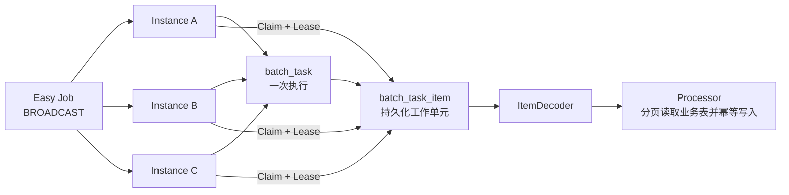
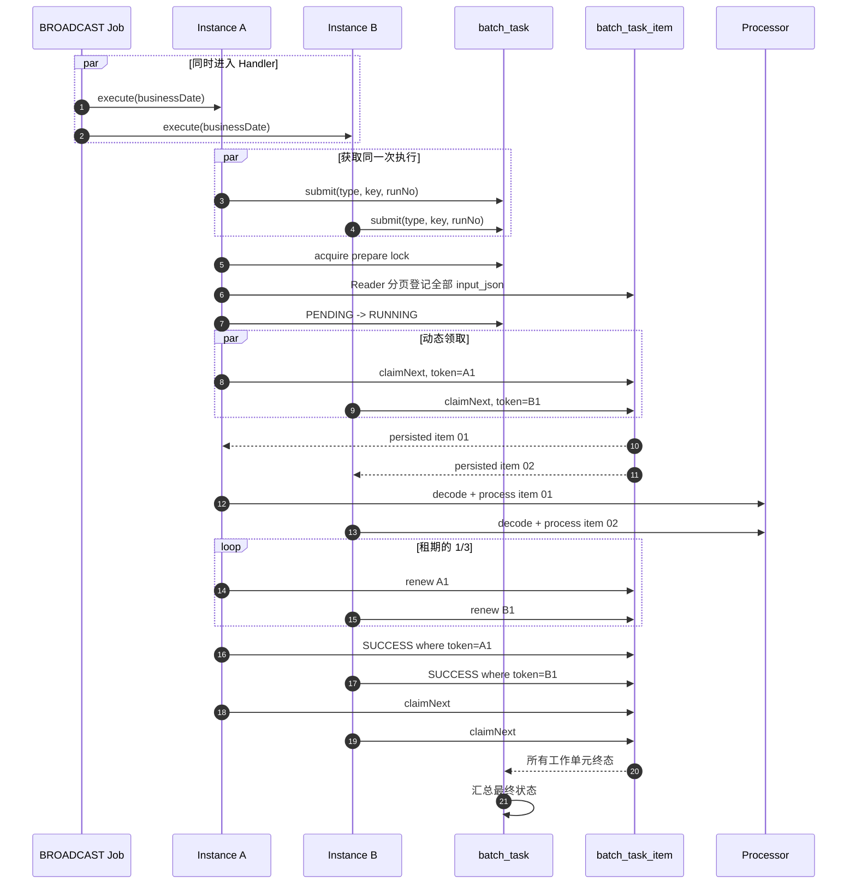
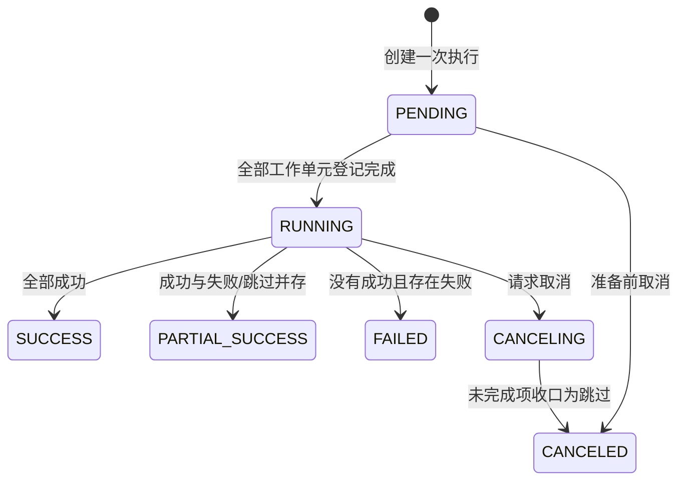
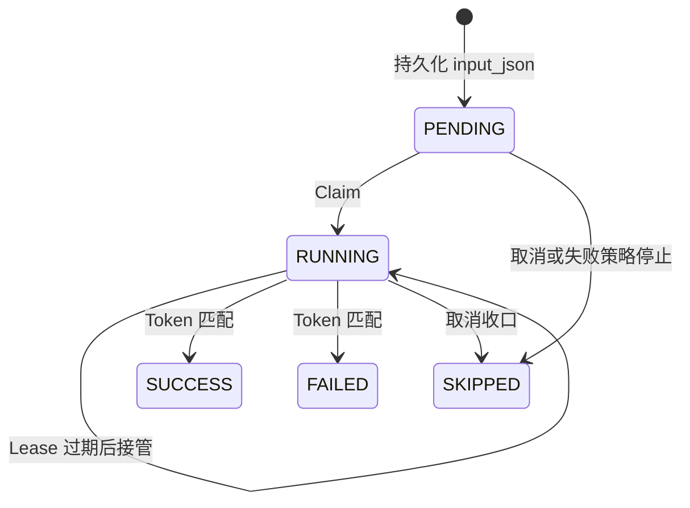
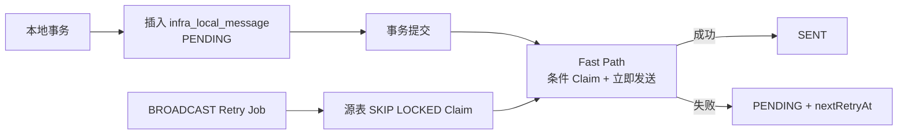

# Easy Batch：用两张表完成可恢复的分布式批处理

每天凌晨需要核对一批已经确定边界的数据。应用有 5 个实例，数据量可能从几万增长到千万。

Easy Batch 的目标不是复刻 Spring Batch，而是保留最重要的执行语义：**一次执行有独立历史、输入工作单元可持久化、多个 Worker 动态领取、宕机后可以从工作单元边界继续。**

## 1. 先区分三类问题

| 问题 | 组件 | 负责内容 |
| --- | --- | --- |
| 什么时候触发 | Easy Job | Cron、启停、单实例/广播、执行日志 |
| 一次批量执行如何拆分和恢复 | Easy Batch | 执行历史、工作单元、进度、Claim/Lease、失败明细 |
| 持续到达的数据如何实时消费 | 源队列表或 MQ | Outbox Claim、Kafka Consumer Group、RabbitMQ ACK |

`BROADCAST` 只让所有实例进入 Handler，并不会自动把 1000 条数据平均分给 5 个实例。数据所有权必须由 Batch 的 Claim/Lease 或源队列表的 Claim 决定。

## 2. 适用边界

适合 Easy Batch：

- 每日对账、周报、月结；
- 固定文件导入；
- 有截止时间或高水位的数据同步；
- 可以拆成稳定 ID 范围、哈希桶、租户或时间片的任务。

不适合先复制成 Batch item：

- 本地消息、实时事件、待消费队列等持续流入数据；
- 用户在线抢单等所有权本身就是领域状态的操作；
- 要求毫秒级分发、强背压或跨服务消费的高吞吐流。

判断标准只有一个：**本次执行能否定义一个有边界的数据集合，并判断何时全部完成。**

## 3. 轻量架构



职责拆分：

- Reader 只在准备阶段生成工作单元；
- `input_json` 是 Worker 的事实输入，Worker 不重放 Reader；
- ItemDecoder 将持久化输入恢复为业务对象；
- Processor 完成业务读取、转换和写入；
- BatchTaskService 是治理 Writer，负责状态、租约、计数和错误摘要。

业务 Writer 没有抽象为万能 DSL。数据库更新、远程调用、文件生成的事务边界完全不同，显式放在 Processor 或领域 Service 中更容易判断幂等性。

## 4. 两张表为什么足够

### 4.1 `batch_task`：一次执行

关键字段：

| 字段 | 含义 |
| --- | --- |
| `task_type` | 稳定任务类型 |
| `business_key` | 业务周期，例如 `PURCHASE_STATUS_RECONCILIATION:DAY:20260628` |
| `run_no` | 同一周期的第几次执行 |
| `status` | 整体执行状态 |
| `total/success/failed/skipped_count` | 工作单元计数 |
| `trigger_type/ref_id` | JOB、MANUAL、API 等触发来源 |
| `params_json` | 本次参数快照 |
| `trace_id` | 与日志和 Trace Tree 关联 |

唯一约束是：

```text
(task_type, business_key, run_no)
```

`business_key` 表示业务周期，`run_no` 表示执行历史。失败补跑必须创建 `run_no + 1`，不能把终态任务改回 `PENDING`，否则会丢失第一次执行的失败证据、耗时和 Worker 轨迹。

进度百分比不入库，通过工作单元计数实时推导：

```text
progress = (success + failed + skipped) / total
```

### 4.2 `batch_task_item`：持久化工作单元

关键字段：

| 字段 | 含义 |
| --- | --- |
| `task_id + item_key` | 一次执行内稳定唯一 |
| `work_type` | `RECORD` 或 `PARTITION` |
| `input_json` | Worker 可独立恢复的输入快照 |
| `status` | `PENDING/RUNNING/SUCCESS/FAILED/SKIPPED` |
| `attempt_count` | 实际领取次数，包含租约接管 |
| `worker_id` | 最后领取实例 |
| `lease_token/until` | 当前限时所有权 |
| `error/result_message` | 排障摘要 |

索引 `(task_id, status, lease_until, id)` 服务于动态领取。治理历史表不提供逻辑删除，也不原地复用终态记录。

## 5. 准备屏障：Reader 只能成功登记一次

如果 A 只登记了第一页分区，B 已处理完这一页并宣布成功，而 A 还没登记第二页，主任务会提前结束。

分布式模式因此分成两个阶段：

1. 所有实例使用相同 `taskType + businessKey + runNo` 获取同一次执行；
2. 一个实例获得 `batch:prepare:{taskId}` 准备锁；
3. 准备者分页执行 Reader，把全部工作单元写入 `batch_task_item`；
4. `task_id + item_key` 唯一索引保证准备重试幂等；
5. 登记完成后，任务从 `PENDING` 进入 `RUNNING`；
6. 所有实例直接从表中 Claim 工作单元。

这里分页的是分区定义，不是复制全部业务数据。千万级订单可以只登记几十或几百个范围：

```text
item_key   = id-range-0001
work_type  = PARTITION
input_json = {"accountDate":"2026-06-28","startId":1,"endId":100000}
```

Worker 领取后，再在范围内按 500 到 2000 条分页读取业务表。

## 6. Claim、Lease 和 Token

当前实现用短事务执行：

```sql
SELECT *
FROM batch_task_item
WHERE task_id = :taskId
  AND (
    status = 'PENDING'
    OR (status = 'RUNNING' AND lease_until < :now)
  )
ORDER BY id
LIMIT 1
FOR UPDATE SKIP LOCKED;
```

领取后在同一事务内写入 `RUNNING / worker_id / lease_token / lease_until` 并累加 `attempt_count`。业务处理发生在事务外，避免远程调用期间长期持有行锁。

Lease 解决“RUNNING 实例已经宕机”的恢复问题：

- Runner 每隔租期的三分之一自动续租；
- 进程停止后租约自然过期；
- 其他实例重新领取过期工作单元；
- 成功、失败和续租都必须匹配 `lease_token`；
- 旧 Worker 恢复后无法覆盖新 Worker 的结果。

```text
A Claim，token=A1
        │
        ├─ A 停顿，Lease 过期
        ▼
B Claim，token=B1
        │
        └─ A1 回写影响 0 行，B1 才是当前所有者
```

Token 只能保护治理状态，不能撤销已经发生的外部副作用。因此 Processor 必须使用业务唯一键、条件 UPDATE 或下游幂等键。

MySQL 官方明确说明 `SKIP LOCKED` 适合 queue-like table 的并发访问，不适合普通一致性查询。[MySQL InnoDB Locking Reads](https://dev.mysql.com/doc/refman/8.4/en/innodb-locking-reads.html)

## 7. 完整时序



这不是“每个实例固定 200 条”。应创建多于实例数的工作单元，让处理快的实例多领取，处理慢或宕机的实例少领取。

## 8. 状态机与断点续跑

主任务：



工作单元：



当前断点粒度是一个 `batch_task_item`：已成功工作单元不会再执行，过期 `RUNNING` 工作单元可接管。分区内部如果在第 80 页宕机，会重新执行该分区，因此分区不能过大，内部写入必须幂等。

只有单个分区执行数小时且重放代价明显时，才应增加 token-fenced `checkpoint_json`。默认不增加逐条 checkpoint，避免把轻量模型变成复杂状态机。

## 9. 真实样例：采购流程状态日终对账

项目内置 `PurchaseStatusReconciliationJob`：

- 每天 01:10 以 `BROADCAST` 唤醒全部实例；
- 业务日期默认为昨天；
- 同一日期首次执行固定 `runNo=1`；
- Reader 先读取候选 ID 高低水位，再登记最多 16 个连续 ID 范围；
- Worker 从持久化 `input_json` 恢复分区；
- Processor 在分区内按 ID 游标分页；
- 采购状态与流程状态不一致时使用带旧状态条件的 UPDATE 修复；
- 批处理页可以选择日期手动触发，新建下一个 `runNo`。

```text
task_type   = PURCHASE_STATUS_RECONCILIATION
business_key= PURCHASE_STATUS_RECONCILIATION:DAY:20260628
run_no      = 1

item_key    = id-range-03
work_type   = PARTITION
input_json  = {"businessDate":"2026-06-28","startId":100001,"endId":150000}
```

这展示了 Easy Job 与 Easy Batch 的边界：Job 只唤醒，Batch 分工，采购领域 Service 解释数据并执行幂等修复。

## 10. 为什么 LocalMessage 不走 Batch

本地消息在业务运行期间持续增加，没有“全部工作单元已经登记完成”的时刻。若每分钟复制到 Batch：

- 相邻批次可能包含同一条消息；
- Outbox 状态与 Batch 状态会重复并漂移；
- 空批次和重复明细造成长期写放大；
- Cron 周期会增加首次发送延迟。

当前实现使用两层路径：



第一次发送在事务提交后立即进行。Fast Path 与广播 Worker 使用同一套 Claim/Lease 所有权：谁先把 `PENDING` 条件更新为 `PROCESSING`，谁负责发送。若进程在提交后、领取前崩溃，消息仍是 `PENDING`，下一次广播可直接接管；Cron 只负责失败重试和崩溃恢复。所有权字段直接位于 `infra_local_message`，因为它本身就是基础设施队列表，不需要再复制一份 `batch_task_item`。

同理：

| 工作负载 | 所有权位置 |
| --- | --- |
| 固定账期对账、报表、同步 | `batch_task_item` |
| Outbox、任务收件箱 | 源队列表 Claim/Lease |
| 在线订单抢单 | 业务表状态条件 UPDATE |
| 高吞吐跨服务事件 | Kafka/RabbitMQ |

## 11. 失败策略与补跑

轻量 Runner 支持：

- `CONTINUE_ON_ERROR`：单项失败后继续；
- `STOP_ON_ERROR`：首次失败后停止并跳过未执行项；
- `STOP_ON_FAILURE_LIMIT`：达到失败阈值后停止。

停止策略只用于当前实例顺序执行的普通模式。分布式 Worker 之间没有共享的失败计数和停止屏障，因此 `distributed=true` 固定使用 `CONTINUE_ON_ERROR`；失败工作单元进入终态后，通过新 `runNo` 选择性补跑。

终态执行不可变。补跑流程是：

1. 根据上一执行的失败/跳过明细或业务条件生成新工作单元；
2. 使用相同 `taskType + businessKey`；
3. 创建 `runNo + 1`；
4. 新执行独立 Claim 和汇总；
5. 页面可对比每次执行历史。

框架不提供“重置原任务”接口，也不假设所有业务都能用同一种方式生成补跑输入。

## 12. 与 Spring Batch 的关系

| Spring Batch 概念 | Easy Batch 对应 | 取舍 |
| --- | --- | --- |
| JobExecution | `batch_task` | 保留一次执行历史和状态 |
| Step/Partition Execution | `batch_task_item` | 合并为一层工作单元 |
| ItemReader | `EasyBatchPageReader` | 支持页码/游标，分布式时仅准备者执行 |
| ItemProcessor/Writer | `EasyBatchItemProcessor` + 领域 Service | 不做通用 Writer DSL |
| ExecutionContext | `params_json + input_json` | 默认只恢复到 item 边界 |
| Partition Handler | `claimNext + lease` | 直接使用 MySQL，不引入远程分区中间件 |

需要多 Step 依赖、Chunk 事务、跳过/重试策略 DSL、作业仓库生态或远程 Chunking 时，应直接采用 Spring Batch，而不是继续扩张 Easy Batch。[Spring Batch Reference](https://docs.spring.io/spring-batch/reference/)

## 13. 生产约束

- 所有实例必须时间同步；时钟偏差不可控时应改用数据库时间判断租约；
- 分区边界必须不重叠，并记录截止时间或高水位；
- Processor 必须幂等，尤其是 Lease 接管场景；
- `input_json` 只保存恢复所需参数，不复制整批业务数据；
- 租约应大于正常单页处理耗时，Runner 会自动续租；
- 工作单元数量应显著多于 Worker，但不能细到让治理开销超过业务处理；
- 历史表需要按企业保留策略归档，不通过逻辑删除篡改执行证据；
- API 手动触发只负责创建执行并异步启动，页面通过任务列表观察进度。

Easy Batch 的核心不是“又一套任务框架”，而是用最少模型把**固定数据集、执行历史、动态分工和故障恢复**连成闭环。
