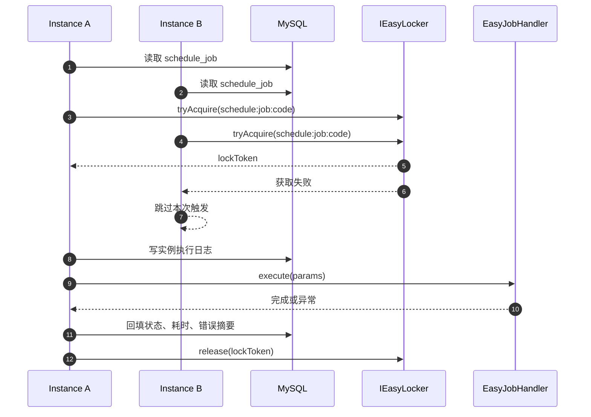
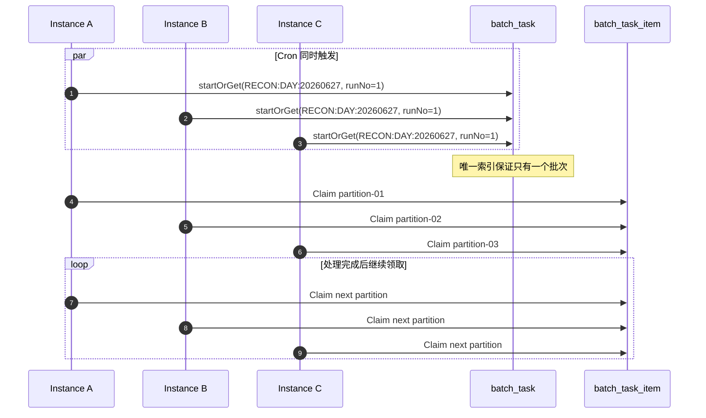

# Easy Job：从单实例定时任务到广播批处理

假设一套企业后台部署了 5 个实例，每天凌晨 2 点需要完成一次对账。

如果 5 个实例都直接执行完整对账，同一批订单会被处理 5 次；如果只允许一个实例执行，正确性容易保证，但另外 4 个实例完全没有参与，数据量上来后单机执行时间又会越来越长。

Easy Job 解决的是“什么时候执行、哪些实例进入执行”。它不负责决定某条业务数据归哪个实例处理。后一个问题交给 Easy Batch 的 Claim/Lease。

## 1. 组件边界

Easy Job 是轻量分布式定时任务组件，提供：

- `@EasyJob` 代码声明；
- `schedule_job` 数据库目标状态；
- 每个实例的本地 Cron 注册；
- 15 秒一次的集群配置对齐和实例心跳；
- `SINGLETON / BROADCAST` 两种集群执行模式；
- 执行日志、instanceId、traceId、耗时和异常摘要。

它不提供完整调度中心、DAG 编排、依赖任务、秒级海量调度或通用数据分片。任务规模超过轻量模型时，应接入 XXL-JOB、PowerJob、ElasticJob 或云调度平台。

## 2. 设计如何演进

### 2.1 第一版：所有实例都注册 Cron

每个实例都能读取相同的 `schedule_job` 配置并注册本地 Cron。这样没有独立调度中心，实例启动后也能自行恢复调度。

但 Cron 到点时，所有实例都会进入 Handler，普通任务会重复执行。

### 2.2 第二版：默认使用集群单实例锁

`SINGLETON` 模式在执行前获取：

```text
schedule:job:{jobCode}
```

只有一个实例获得分布式锁，其余实例跳过。锁自动续租，进程崩溃后由租约释放。

这适合生成普通报表、清理共享表等“整个集群只执行一次”的任务。源队列表已经具备 Claim/Lease 时，也可以使用广播唤醒多个 Worker。

### 2.3 第三版：固定账期需要广播唤醒

每日对账已经拆成 50 个业务分区时，只让一个实例进入 Handler 会浪费其他实例。于是增加 `BROADCAST`：

- 每个在线实例都执行 Handler；
- 不获取 Job 全局锁；
- 所有实例使用同一个固定账期 `businessKey + runNo`；
- Easy Batch 原子领取不同分区。

广播只负责唤醒，不能防止重复处理。正确性来自唯一批次、Claim/Lease、Token 和业务幂等。

## 3. 核心模型

| 模型 | 作用 |
| --- | --- |
| `@EasyJob` | 声明任务编码、名称、Cron、锁租约和集群执行模式。 |
| `schedule_job` | 保存数据库目标状态、Cron、执行类、`execution_mode` 和租约。 |
| `schedule_instance` | 保存应用实例、主机、进程和最近心跳。 |
| `ScheduleJobManager` | 扫描声明、注册本地 Cron、同步数据库状态并选择执行策略。 |
| `IEasyLocker` | 为 `SINGLETON` 任务提供 MySQL/Redis 分布式锁及自动续租。 |
| `schedule_job_log` | 每个真实执行实例写一条日志，记录 runId、instanceId、traceId 和结果。 |

数据库是控制面的事实来源，本地 Cron 是数据库目标状态在当前 JVM 的执行副本。

## 4. 两种执行模式

| 模式 | 谁进入 Handler | 是否使用 Job 全局锁 | 适合场景 |
| --- | --- | --- | --- |
| `SINGLETON` | 集群内一个实例 | 是 | 共享表清理、普通报表、状态巡检 |
| `BROADCAST` | 每个在线实例 | 否 | 分布式批处理启动、本机缓存刷新、本机文件清理 |

默认必须是 `SINGLETON`。只有 Handler 本身明确使用 Claim/Lease，或者动作本来就要求每台机器执行时，才选择广播。

```java
@EasyJob(
        jobCode = "recon_daily",
        jobName = "每日对账",
        cron = "0 0 2 * * ?",
        executionMode = JobExecutionMode.BROADCAST
)
public class DailyReconciliationJob implements EasyJobHandler {
    // 每个实例都会进入 execute，业务分区由 Easy Batch 动态领取。
}
```

## 5. 单实例执行流程



## 6. 广播批处理执行流程



这里没有给实例静态分配“每台 200 条”。处理快的实例会继续领取，实例宕机后，其租约到期分区由其他实例接管。

## 7. 为什么不再增加 Redis 广播

固定时间任务已经由每个实例的本地 Cron 唤醒。如果再发布一次 Redis Pub/Sub，只是把同一件事做两遍，并增加消息丢失、订阅恢复和运维依赖。

因此当前取舍是：

```text
固定周期批处理：BROADCAST Job 直接唤醒
API/人工批处理：调用方实例启动 Runner
数据分工与恢复：统一由 BatchTaskItem Claim/Lease 完成
```

Redis/MQ 只有在 Worker 与调度服务需要独立部署、跨服务消费或需要队列背压时才值得引入。

## 8. 控制面一致性

多实例最容易出现的问题不是 Cron 本身，而是某节点已经停止任务，其他节点仍保留旧 Cron。

Easy Job 的处理方式：

1. 页面启动、停止、保存先更新数据库；
2. 当前节点立即 reconcile；
3. 所有节点每 15 秒写心跳并读取 `schedule_job`；
4. Cron、状态、租约或执行模式变化时重建本地任务；
5. 真正执行前再次读取数据库，确认仍处于可运行状态。

`START / STOP` 表示期望状态，不表示当前一定有线程在执行。

## 9. 失败场景与边界

| 故障 | 当前行为 |
| --- | --- |
| 单实例任务执行节点宕机 | Job 锁租约到期后，下一次 Cron 可由其他节点获取。 |
| 广播任务某个 Worker 宕机 | Batch Item Lease 到期，仍在线 Worker 接管。 |
| 所有实例在触发时停机 | 当前不会自动补齐所有错过时刻；需启动恢复或业务补跑。 |
| 广播 Handler 不是幂等批处理 | 可能在每个实例重复产生副作用，禁止这样配置。 |
| 新实例在广播后才启动 | 不参加这次 Job 调用；未完成批次可由后续恢复入口继续。 |

广播不是 exactly-once。业务写入仍要使用业务唯一键、状态条件更新或幂等消费。

## 10. 参考与取舍

- [Spring Batch Scaling and Parallel Processing](https://docs.spring.io/spring-batch/reference/scalability.html)：Manager/Worker、Partitioning 和从简单方案开始演进。
- [Kubernetes Leases](https://kubernetes.io/docs/concepts/architecture/leases/)：租约用于限时所有权、心跳和 Leader Election。
- [Quartz JDBC JobStore Clustering](https://www.quartz-scheduler.org/documentation/quartz-2.3.0/configuration/ConfigJDBCJobStoreClustering.html)：共享数据库协调集群调度。
- [XXL-JOB 官方文档](https://www.xuxueli.com/xxl-job/en/)：执行器、路由和分片广播模型。

Easy Job 选择的是中小企业可直接落地的最小闭环：数据库控制面、本地 Cron、单实例锁、广播入口和可观测执行日志。复杂调度平台能力不在应用脚手架里重复实现。
